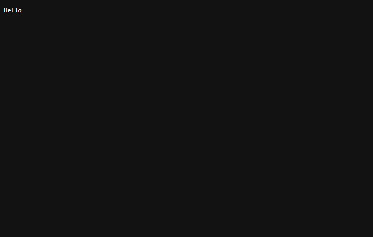
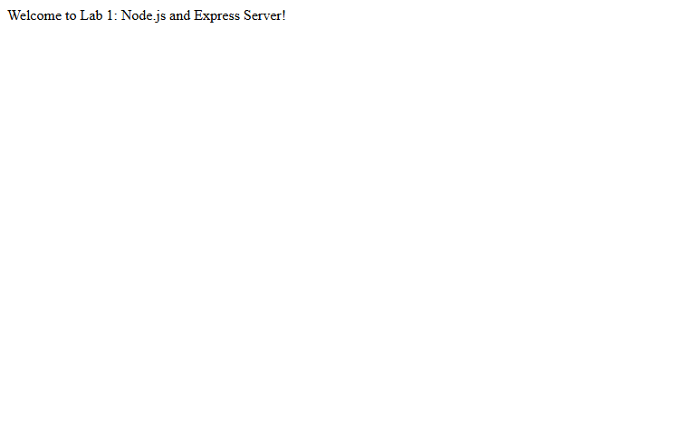
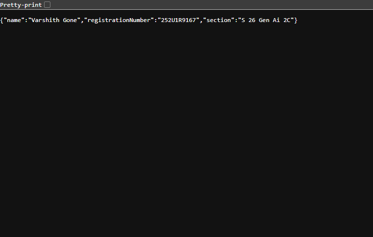
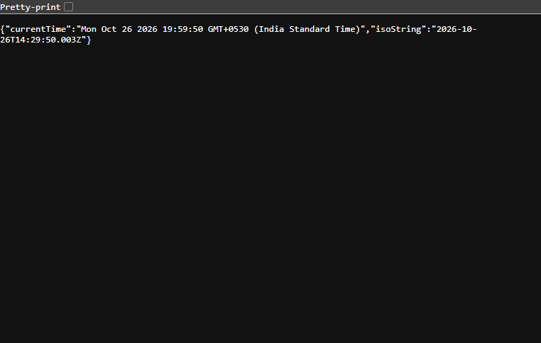
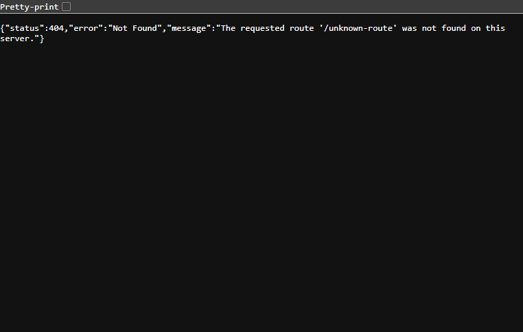

# Lab 1: Node.js and Express server

### Student Details
- **Name:** Varshith Gone
- **Registration Number:** 252U1R9167
- **Section:** S 26 Gen Ai 2C
- **Course:** Backend Development Fundamentals (Year II Term II)
- **Faculty:** Joel Prashanth D
- **Reference Repository:** [shaik-creator/Backend_development_fundamentals_lab_01](https://github.com/shaik-creator/Backend_development_fundamentals_lab_01)

---

## Live Link
- **Live Deployment:** Not applicable (local development server; deployment available on Render/Railway if needed)

---

## Objective
Set up a Node.js project and build a small web server, first with the built-in `http` module and then with Express.js, implementing custom routes and standard HTTP status codes.

---

## Project Structure

```text
bds/
├── .gitignore
└── lab-01/
    ├── .gitignore
    ├── package.json
    ├── package-lock.json
    ├── server-http.js
    ├── server.js
    ├── README.md
    └── screenshots/
        ├── http-server.png
        ├── home.png
        ├── about.png
        ├── time.png
        └── not-found.png
```

---

## Explanation of `package.json` Fields

When running `npm init -y`, a `package.json` manifest is created. Here is the explanation of each key field:

| Field | Purpose |
|---|---|
| `name` | The unique name of the project or package (lowercased and URL-friendly). |
| `version` | The semantic version of the project following `MAJOR.MINOR.PATCH` format (e.g. `1.0.0`). |
| `description` | A brief summary describing what the project does. |
| `main` | The entry-point file of the application (e.g. `server.js`). |
| `scripts` | Custom CLI shortcut commands that can be run with `npm run <command>` (e.g. `npm start`). |
| `keywords` | An array of tags or keywords to help users discover the package on npm. |
| `author` | The creator/maintainer of the project (`Varshith Gone`). |
| `license` | The open-source or proprietary license under which the software is distributed (e.g. `ISC`). |
| `dependencies` | A list of production packages and their compatible versions required to run the project (e.g., `"express": "^5.3.0"`). |

---

## How to Run

### 1. Prerequisites
- [Node.js](https://nodejs.org/) installed (v18 or higher recommended).
- npm installed (comes bundled with Node.js).

### 2. Installation
Navigate into the `lab-01` directory and install the dependencies:

```bash
cd lab-01
npm install
```

### 3. Environment Variables
No required environment variables for local execution. Port defaults to `3000` (configurable via `PORT` environment variable).

### 4. Running the Servers

#### A. Plain Node.js HTTP Server (`server-http.js`)
To run the server created using Node.js's built-in `http` module:
```bash
node server-http.js
# Or using npm script:
npm run start:http
```
Visit: `http://localhost:3000/`

*(Press `Ctrl + C` to stop the server before running the Express server).*

#### B. Express Server (`server.js`)
To run the full Express server with all routes:
```bash
node server.js
# Or using npm script:
npm start
```
Visit: `http://localhost:3000/`

---

## Endpoints Table

| HTTP Method | Endpoint | Description | Expected Status Code | Response Type |
|---|---|---|---|---|
| `GET` | `/` | Welcome message text | `200 OK` | `text/plain` |
| `GET` | `/about` | JSON containing student name, registration number, and section | `200 OK` | `application/json` |
| `GET` | `/time` | Current date and time using `new Date()` | `200 OK` | `application/json` |
| `GET` | `*` (Any unknown route) | Error response for undefined routes | `404 Not Found` | `application/json` |

---

## Screenshots

> All screenshots use names without spaces and are located in `./screenshots/`.

### 1. Plain HTTP Server (`GET /`)
Responds with "Hello" using Node's built-in `http` module:



---

### 2. Express Server: Welcome Route (`GET /`)
Status code: `200 OK`



---

### 3. Express Server: About Route (`GET /about`)
Status code: `200 OK` (Returns student details as JSON)



---

### 4. Express Server: Time Route (`GET /time`)
Status code: `200 OK` (Returns current system time generated via `new Date()`)



---

### 5. Express Server: 404 Route (`GET /unknown-route`)
Status code: `404 Not Found` (Custom 404 handler for unknown paths)



---

## Viva Questions & Answers

### 1. What is the difference between `package.json` and `node_modules`?
- **`package.json`**: A lightweight metadata manifest file that records project configuration, scripts, author, and names/version ranges of dependencies. It is meant to be committed to version control.
- **`node_modules`**: The directory that stores the actual downloaded code and dependencies (including all nested transitive dependencies). It is very large and should **never** be committed to Git (it is excluded via `.gitignore`). Any developer can regenerate it by running `npm install`.

### 2. What does `app.listen()` do?
- `app.listen(port, [callback])` binds and listens for incoming HTTP connections on the specified port number. Under the hood, it creates a Node.js `http.Server` instance using the Express application as the request handler callback.

### 3. What do `request` and `response` represent?
- **`request` (`req`)**: Represents the incoming HTTP request from the client. It contains request details such as URL parameters, query strings, headers, HTTP method, and body data.
- **`response` (`res`)**: Represents the outgoing HTTP response that the server sends back to the client. It provides methods like `res.status()`, `res.send()`, `res.json()`, and `res.setHeader()` to format and finalize the response.

---

## Notes: Problems Faced and Solutions

1. **Port Collision (`EADDRINUSE`)**:
   - *Problem:* Attempting to run `server.js` while `server-http.js` was still listening on port 3000 resulted in an `EADDRINUSE` error.
   - *Solution:* Stopped the previous server process with `Ctrl + C` (or terminating the background process) before launching the new server. Configured `process.env.PORT || 3000` to allow overriding the port when necessary.

2. **Preventing `node_modules` in Version Control**:
   - *Problem:* Installing packages creates a massive `node_modules/` folder that should not be tracked by Git.
   - *Solution:* Added a `.gitignore` file both at the root and in `lab-01/` with `node_modules/` specified before staging any files.
